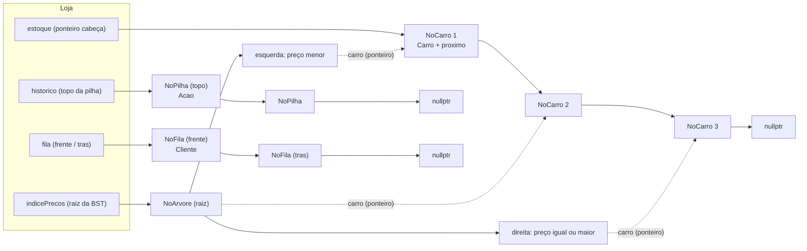

# AutoGestão — Sistema de Loja de Carros (C++)

Projeto Final — Programação e Sistemas Computacionais II · Centro Universitário Campo Real · Engenharia de Software · 2026/1
Professor: Giovane Galvão

## Descrição do sistema

**Tema escolhido: tema próprio — Loja de Carros (gestão de estoque, vendas e atendimento).**

O AutoGestão é um sistema de terminal que gerencia o estoque de uma loja de veículos:

- cadastra, lista, edita, remove e busca carros;
- registra vendas e permite **desfazer** as últimas ações (cadastro, remoção e venda);
- organiza uma **fila de atendimento** de clientes, oferecendo a venda do carro de interesse de quem é atendido;
- consulta o estoque **por preço** (lista ordenada e faixa de preço);
- ordena o estoque por código, preço ou ano;
- **compara busca sequencial × binária** com contagem de comparações e medição de tempo.

### Justificativa do tema e das estruturas

| Necessidade da loja | Estrutura | Por quê |
|---|---|---|
| Guardar o estoque, que cresce e diminui toda hora | **Lista encadeada** | Inserção O(1) no início, remoção sem deslocar elementos, tamanho não precisa ser definido antes |
| Desfazer a última ação (Ctrl+Z) | **Pilha** (LIFO) | A última ação feita é a primeira a ser desfeita |
| Clientes aguardando atendimento | **Fila** (FIFO) | Quem chegou primeiro é atendido primeiro |
| Ver carros por preço / faixa de preço | **Árvore binária de busca** | A travessia in-ordem entrega os preços já ordenados e a faixa de preço poda ramos inteiros |
| Organizar o estoque | **Bubble Sort** | Algoritmo implementado do zero, aplicado a um vetor de ponteiros |
| Achar um carro por código | **Busca sequencial** (lista) e **binária** (vetor ordenado) | Comparação de desempenho O(n) × O(log n) |

## Diagrama de estruturas de dados



Os nós da árvore **não copiam** o carro: guardam um ponteiro para o `NoCarro` da lista. A árvore é reconstruída antes de cada consulta, para nunca apontar para um carro removido.

Para ordenar e para a busca binária, o sistema monta um **vetor de ponteiros** (`NoCarro**`, alocado com `new[]`) apontando para os nós da lista. Ordenar troca ponteiros, não structs inteiras.

## Requisitos técnicos (onde cada um está)

| # | Requisito | Onde |
|---|---|---|
| R1 | Funções | Todo o código: funções de responsabilidade única (≤ 30 linhas). Passagem por valor (`lerCarro(int codigo)`), por referência (`Loja&`, `NoCarro*&`, `long& comparacoes`) e **parâmetros default** (`lerInteiro(msg, minimo = INT_MIN, maximo = INT_MAX)`) |
| R2 | Ponteiros | `NoCarro*`, `NoCarro**` (vetor de ponteiros), `NoArvore*`, referência a ponteiro (`NoCarro*&`), **ponteiro para função** (`Criterio`) |
| R3 | Recursividade | `contarCarros`, `contarVendidos`, `tamanhoPilha`, inserção/busca/travessia/altura/liberação da árvore, `buscaBinaria` |
| R4 | Memória dinâmica | `new`/`delete` em todos os nós; `new[]`/`delete[]` no vetor auxiliar; `liberarLoja` ao sair |
| R5 | Lista encadeada | `lista_carros.h`: `inserirNoInicio`, `removerNo`, `listarCarros`, `buscarNo` |
| R6 | Pilha | `pilha_acoes.h`: `empilhar`, `desempilhar` — usada em `desfazerUltimaAcao` |
| R7 | Fila | `fila_clientes.h`: `enfileirar`, `desenfileirar` — usada em `atenderProximoCliente` |
| R8 | Árvore binária de busca | `arvore_precos.h`: `inserirNaArvore`, `buscarPrecoExato`, `listarEmOrdem`, `listarFaixaPreco` |
| R9 | Ordenação | `ordenacao.h`: `bubbleSort` com análise de complexidade comentada |
| R10 | Busca | `busca.h`: `buscaSequencial`, `buscaBinaria` e `compararBuscas` (comparações + tempo) |

## Estrutura de arquivos

```
carro.h            structs Carro e NoCarro
entrada.h          leitura segura do teclado (valida entradas)
lista_carros.h     lista encadeada do estoque
pilha_acoes.h      pilha de ações (desfazer)
fila_clientes.h    fila de atendimento
arvore_precos.h    árvore binária de busca por preço
ordenacao.h        Bubble Sort sobre vetor de ponteiros
busca.h            busca sequencial, binária e comparação
loja.h             struct Loja e operações que combinam as estruturas
dados_teste.h      gerador de carros de teste (para a comparação de buscas)
menu.h             menu e opções
main.cpp           laço principal
RELATORIO_TECNICO.txt   relatório de decisões de projeto
```

## Como compilar e executar

Requer `g++` com suporte a C++17.

```bash
make          # compila
./lojadecarros
```

Ou, sem `make`:

```bash
g++ -std=c++17 -Wall -Wextra main.cpp -o lojadecarros
```

### Roteiro rápido de demonstração

1. Opção **16**: gerar 3000 carros de teste.
2. Opção **15**: comparar busca sequencial × binária (nº de comparações e tempo).
3. Opção **6**: ordenar por preço (Bubble Sort).
4. Opções **12**, **13** e **14**: consultas pela árvore (ordem crescente, faixa de preço, preço exato).
5. Opções **7** e **8**: vender um carro e desfazer (pilha).
6. Opções **9**, **10** e **11**: fila de clientes.
7. Opção **17**: estatísticas (altura da árvore, tamanho da pilha etc.).

## Divisão de responsabilidades

> **Preencher com os nomes reais do squad antes de entregar.** A divisão abaixo é uma sugestão por módulo; ajuste conforme quem de fato implementou cada parte (e mantenha os commits de cada um no histórico).

| Integrante | Parte implementada | Arquivos |
|---|---|---|
| [Integrante 1] | Lista encadeada do estoque, cadastro/edição/remoção, entrada de dados | `carro.h`, `lista_carros.h`, `entrada.h` |
| [Integrante 2] | Pilha de ações (desfazer) e fila de atendimento | `pilha_acoes.h`, `fila_clientes.h`, `loja.h` |
| [Integrante 3] | Árvore binária de busca por preço | `arvore_precos.h` |
| [Integrante 4] | Ordenação, buscas, comparação de desempenho, menu, relatório | `ordenacao.h`, `busca.h`, `dados_teste.h`, `menu.h`, `main.cpp` |

## Gerenciamento de memória

- Todo `new` tem um `delete` correspondente; ponteiros liberados recebem `nullptr`.
- `liberarLoja` libera lista, pilha, fila e árvore ao encerrar o programa.
- A árvore guarda apenas ponteiros para os carros, então liberá-la não apaga carros.
- Verificado com `g++ -fsanitize=address,undefined`, sem vazamentos nem acessos inválidos.
